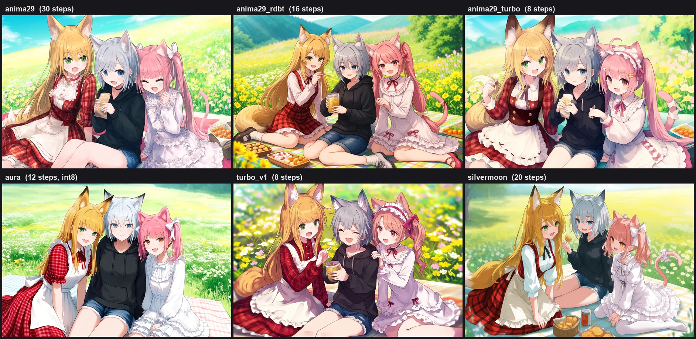

# AnimaFlow

> 前身 ComfyUI-AnimaTool。把 ComfyUI 上的 Anima 系列模型包装成 AI Agent 可直接调用的统一 Tool Use API，现已整合 **Anima 2.9B 系列全套工作流**：完整模型、Turbo LoRA（8 步）、融合 UNET（8 步）、rdbt 双 LoRA（16 步）与 Aura Int8 量化。

<p align="center">
  Cursor / Claude / Gemini / OpenAI → MCP / HTTP API → ComfyUI → Anima 模型
</p>

## 特性

- **整合 Anima 2.9B 系列**：`anima29` 完整 UNET + `anima29_turbo`（Turbo LoRA，8 步）+ `fuse`（融合 UNET，8 步，内置文字类负面）+ `anima29_rdbt`（rdbt v2.0 双 LoRA，16 步）+ `aura` / `aura_speed`（Int8 量化，显存减半），质量与速度多档可选
- **多工作流统一 API**：base / turbo 系 / 2.9B / Aura 等多模型，通过 `workflow` 参数切换
- **工作流发现 API**：`GET /anima/workflows` 返回全部工作流的 schema、知识与弃用状态，下游服务启动时动态拉取即可，工作流增删改无需额外适配
- **三种接入方式**：MCP Server（图片原生显示在聊天窗口）、ComfyUI 内置 HTTP API、独立 FastAPI / CLI
- **结构化提示词**：按各模型规范自动拼接（tag 系 / 自然语言系各自匹配）
- **14 种长宽比预设**（21:9 ~ 9:21）、`repeat` / `batch_size` 批量生成、历史记录与 reroll

## 安装

> ComfyUI Manager 暂时无法安装本插件，请使用手动安装。

```bash
cd ComfyUI/custom_nodes
git clone https://github.com/Langzaigg/ComfyUI-AnimaFlow.git
pip install -r ComfyUI-AnimaFlow/requirements.txt
```

安装后重启 ComfyUI。

所需模型文件（按工作流选用，文件名可用环境变量覆盖）：

| 文件 | 路径 | 说明 |
|------|------|------|
| `anima-preview.safetensors` | `models/diffusion_models/` | Anima base UNET |
| `anima29B_v10.safetensors` | `models/diffusion_models/` | Anima 2.9B UNET |
| `anima29b-sm29t-fuse1.1.safetensors` | `models/diffusion_models/` | fuse 融合 UNET v1.1（非官方融合衍生；旧版 fuse1.0 对应 `anima29b-p1-turbo1.1.safetensors`，已过期） |
| `anima29b-turbolora1.1.safetensors` | `models/loras/` | anima29_turbo 的 Turbo LoRA v1.1（强度 0.8，免补丁重映射版，非官方衍生） |
| `qwen_3_06b_base.safetensors` | `models/text_encoders/` | Qwen3 CLIP |
| `qwen_image_vae.safetensors` | `models/vae/` | VAE |

模型下载：[circlestone-labs/Anima on Hugging Face](https://huggingface.co/circlestone-labs/Anima)（base）、[Gazingstars123/Anima-2.9B](https://huggingface.co/Gazingstars123/Anima-2.9B)（2.9B）、[Turbo-ANIMA on Civitai](https://civitai.com/models/2619830/turbo-for-anima-less-steps)（Turbo LoRA 原始出处）、[SilvermoonMix Anima Evolved on Civitai](https://civitai.com/models/2639339/silvermoonmix-anima-evolved)（silvermoon / fuse v1.1 融合基底）。fuse 融合 UNET 与 Turbo LoRA 重映射版为本项目的**非官方**融合/重映射衍生（CircleStone 非商业许可）：v1.1（现行）发布于 [Langzaigg/anima29b-turbo1.1-unofficial](https://huggingface.co/Langzaigg/anima29b-turbo1.1-unofficial)，v1.0（已过期）发布于 [Langzaigg/anima29b-turbo-unofficial](https://huggingface.co/Langzaigg/anima29b-turbo-unofficial)。各工作流对应的具体模型文件见其 schema / knowledge 文档。

## 使用

### 方式 1：MCP Server（推荐，图片原生显示）

在 Cursor 项目根目录创建 `.cursor/mcp.json`：

```json
{
  "mcpServers": {
    "anima-tool": {
      "command": "C:\\ComfyUI\\.venv\\Scripts\\python.exe",
      "args": ["C:\\ComfyUI\\custom_nodes\\ComfyUI-AnimaFlow\\servers\\mcp_server.py"]
    }
  }
}
```

重启 Cursor 后直接对 AI 说「画一个穿白裙的少女在花园里，竖屏 9:16，safe」即可。详见 [MCP_SETUP.md](MCP_SETUP.md)。

> 云端/远程 ComfyUI 或不想装到 custom_nodes：可用独立 PyPI 包 `uvx --from comfyui-animatool animatool-mcp`，仅通过 ComfyUI 标准 API 工作。

### 方式 2：ComfyUI 内置 HTTP API

启动 ComfyUI 后自动注册：

| 路由 | 方法 | 说明 |
|------|------|------|
| `/anima/workflows` | GET | **列出所有工作流**（含描述与弃用状态），供下游动态适配 |
| `/anima/schema` | GET | Tool Schema（`?workflow=` 选择，缺省 base） |
| `/anima/knowledge` | GET | 专家知识（`?workflow=` 选择，缺省 base） |
| `/anima/generate` | POST | 生成（body 顶层 `workflow` 字段选择；支持 `repeat` 批量） |
| `/anima/history` | GET | 最近生成历史 |
| `/anima/reroll` | POST | 基于历史记录重新生成 |

```bash
curl -X POST "http://127.0.0.1:8188/anima/generate" \
  -H "Content-Type: application/json" \
  -d '{"workflow":"anima29_turbo","aspect_ratio":"3:4","count":"1girl","tags":"white dress, smile, garden"}'
```

### 方式 3：独立 FastAPI / CLI

```bash
pip install fastapi uvicorn
python -m servers.http_server   # http://127.0.0.1:8000/docs
python -m servers.cli --help
```

## 工作流一览

`GET /anima/workflows` 始终返回最新列表（下游应以此为准）：

| 工作流 | 说明 |
|--------|------|
| `anima29_turbo` | Anima 2.9B + Turbo LoRA v1.1（默认 8 步）——速度优先推荐 |
| `fuse` | Silvermoon29 Turbo × turbo 1.1 融合 UNET v1.1（默认 10 步，cfg 固定 1，Euler a，无负面） |
| `fuse1.0` | （已过期）turbo × Anima 2.9B 融合 UNET v1.0（默认 8 步，内置文字类负面） |
| `anima29_rdbt` | Anima 2.9B + rdbt v2.0 双 LoRA（默认 16 步）——质量/速度均衡最优 |
| `anima29` | Anima 2.9B 完整 UNET（cfg 3.5-5，默认 30 步）——质量优先 |
| `aura` / `aura_speed` | AuraAnima 2.9B Int8 量化，精度重视（er_sde+beta, 12 步）/ 速度重视（euler+simple, 10 步），显存约为 BF16 一半 |
| `base` | Anima base 1.0 完整字段工作流（默认） |
| `turbo_v1` / `aesthetic_v1` | Turbo 1.0 独立 UNET / Aesthetic 1.0 高质量微调 |
| `ultrareal` / `silvermoon` | 写实照片风微调 / Silvermoon 混合模型 |
| `cyberreal` | CyberRealistic Anima（写实插画微调，默认 28 步 cfg 4.5，er_sde+beta） |

各工作流的提示词规范、参数范围见对应的 schema 与 knowledge 文档（`schemas/`、`knowledge/`，或经 `/anima/schema?workflow=xxx` 获取）。

## 工作流特点与选型

同一提示词、同一 seed（3 人兽耳娘野餐场景，3:2）下各工作流的实际出图对比：



**Anima 2.9B 系列（当前主力）**——提示词用自然语言长句 + Danbooru 标签混合，**不要**质量/分数标签，画师/角色/作品标签避免 `_`：

- `anima29`：质量天花板。cfg>1 负面提示词正常生效，细节刻画与复杂构图最好；代价是 30 步起步、BF16 显存约 16GB。适合最终成稿。
- `anima29_rdbt`：双 LoRA 蒸馏加速，16 步实测追平甚至反超 anima29 的 30 步，细节保留完整，是 2.9 系**性价比最优**的日常选择。
- `anima29_turbo`：8 步出图，速度最快档。负面首选**正向写法**规避；管不住的元素写 `neg`（默认以 cfg 1.2 生效），不写 neg 时默认 cfg 1.0。适合快速迭代、聊天实时出图。
- `fuse`：Silvermoon29 Turbo 与 turbo 1.1 的融合 UNET v1.1，10 步 Euler a + normal，cfg 固定 1、无负面；提示词走 turbo 体系（质量词有效）。旧版 v1.0（turbo × Anima 2.9B，8 步，内置文字类负面）保留为已过期的 `fuse1.0`。

fuse v1.1 示例（10 步 cfg 1 Euler a 无负面）：


**Aura 系列（Int8 量化）**——显存约为 BF16 一半，质量与速度却与 BF16 anima29 同档，cfg>1 负面生效。提示词在 anima29 规范基础上加风格标签三选一：`photo real`（默认，写实辅助）/ `anime color`（动漫辅助，可配画师 tag）/ `real skin`：

- `aura`：精度重视（er_sde+beta，12 步），复杂场景与画质优先。
- `aura_speed`：速度重视（euler+simple，10 步），批量、迭代、简单场景优先。

**经典系列（base 1.0 谱系）**——提示词为 tag 系规范：质量/年份/安全标签必备，画师必须带 `@`：

- `base`：字段最完整的工作流（默认），提示词体系最成熟，兼容性最好。
- `turbo_v1`：老一代快速方案（独立 UNET，8-12 步），画风偏经典日系，适合怀旧风格或对比测试。
- `aesthetic_v1`：高质量微调（20-60 步），适合慢工出细活。
- `ultrareal`：写实照片风微调，提示词为「@前缀标签 + 自然语言 + @年份/score 后缀」三段式，与其他工作流差异最大。
- `silvermoon`：混合模型（24 步），score_N 质量前缀，画面明亮清透，介于动漫与半写实之间。
- `cyberreal`：写实插画微调（28 步），score_N + 风格槽提示词（默认真实感写法 `real life, realistic`），肤质/面部细节强；cfg>1 负面常驻生效。半写实角色与写实 leaning 场景优先。

## 配置

全部配置可用环境变量覆盖，常用项：

| 环境变量 | 默认值 | 说明 |
|----------|--------|------|
| `COMFYUI_URL` | `http://127.0.0.1:8188` | ComfyUI 地址（远程/Docker 时修改） |
| `COMFYUI_MODELS_DIR` | - | models 根目录，启用模型预检查与 LoRA sidecar 列表 |
| `ANIMATOOL_OUTPUT_DIR` | `./outputs` | 图片输出目录 |
| `ANIMATOOL_TIMEOUT` | `600` | 生成超时（秒） |
| `ANIMATOOL_TARGET_MP` | `1.0` | 目标像素数（MP） |

完整配置与远程部署说明见 wiki。

## 文档

- [📖 Wiki](wiki/Home.md)：安装教程、提示词指南、API 参考、模型对比
- [MCP_SETUP.md](MCP_SETUP.md)：MCP 客户端配置（含酒馆 SillyTavern）
- [MIGRATION.md](MIGRATION.md)：版本迁移说明与下游 API 适配指南
- [CURSOR_SKILL.md](CURSOR_SKILL.md)：给 Cursor/Windsurf 的 Agent Skill
- [CHANGELOG.md](CHANGELOG.md)：更新记录

## 相关项目

- [anima29b-turbo1.1-unofficial](https://huggingface.co/Langzaigg/anima29b-turbo1.1-unofficial)：本项目发布的 fuse 融合 UNET v1.1（`anima29b-sm29t-fuse1.1`，[SilvermoonMix Anima Evolved](https://civitai.com/models/2639339/silvermoonmix-anima-evolved) × anima-turbo 衍生）与 Turbo LoRA v1.1（`anima29b-turbolora1.1`，[Turbo-ANIMA](https://civitai.com/models/2619830/turbo-for-anima-less-steps) v4 重映射版）——非官方融合/重映射衍生，CircleStone 非商业许可
- [anima29b-turbo-unofficial](https://huggingface.co/Langzaigg/anima29b-turbo-unofficial)：v1.0 旧版（fuse1.0 融合 UNET `anima29b-p1-turbo1.1` 与 `anima29b-turbo-v2.9-remap` LoRA，已过期）——非官方拼接/重映射衍生，CircleStone 非商业许可
- [SillyTavern MCP Client](https://github.com/Moeblack/sillytavern-mcp-client)：酒馆 MCP 客户端（stdio + Streamable HTTP）
- [SillyTavern Tool Use Fix](https://github.com/Moeblack/sillytavern-tooluse-fix)：工具调用体验修复
- [AnimaLoraToolkit](https://github.com/Moeblack/AnimaLoraToolkit)：Anima LoRA/LoKr 训练工具，产物可直接配合本工具 `loras` 参数使用

## License

AGPL-3.0 License - see [LICENSE](LICENSE) for details.
